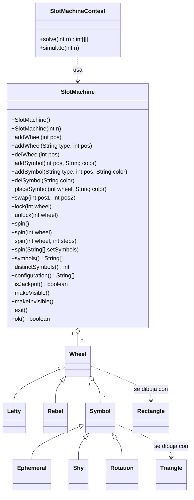
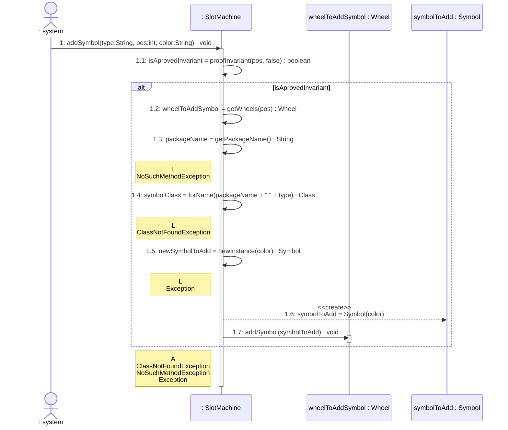

# SlotMachine — Proyecto Inicial DOPO 2026-2

Simulador orientado a objetos de una máquina tragamonedas, inspirado en el **Problem I (Slot Machine)** de la maratón de programación internacional 2025. Cada rueda guarda símbolos de colores distintos y la máquina gana (*jackpot*) cuando todos los símbolos seleccionados tienen el mismo color.

| | |
|---|---|
| **Curso** | Desarrollo Orientado por Objetos (DOPO-POOB) — Escuela Colombiana de Ingeniería Julio Garavito |
| **Autores** | Pablo Andrés Gualdrón Lindo Samuel Villagran|
| **Repositorio** | https://github.com/PaglkG/Proyecto1-DOPO |
| **Tecnología** | Java 8, JUnit 4.13.2, Maven, JaCoCo 0.8.10, PMD 3.21.2, VS Code (los ciclos 1 a 4 se hicieron en BlueJ) |
| **Estado** | Ciclos 1 a 5 completos |

## Contenido

1. [Resumen del proyecto](#1-resumen-del-proyecto)
2. [Ciclos de desarrollo](#2-ciclos-de-desarrollo)
3. [Diseño](#3-diseño)
4. [Tipos de ruedas y símbolos](#4-tipos-de-ruedas-y-símbolos-ciclo-4)
5. [Estructura del repositorio](#5-estructura-del-repositorio)
6. [Cómo ejecutarlo](#6-cómo-ejecutarlo)
7. [Calidad: pruebas, JaCoCo y PMD](#7-calidad-pruebas-jacoco-y-pmd-ciclo-5)
8. [Retrospectiva](#8-retrospectiva)
9. [Prueba de aceptación](#9-prueba-de-aceptación)
10. [Diagrama de secuencia](#10-diagrama-de-secuencia)

---

## 1. Resumen del proyecto

El proyecto se construyó en cinco ciclos de refactorización y extensión. Primero se hizo el **simulador** (ruedas, símbolos, giros y consultas), luego se le agregaron **bloqueos, intercambios y giros controlados**, después se resolvió el **problema de la maratón** sobre ese simulador, se añadieron **tipos de ruedas y símbolos** y, por último, se midió y mejoró la calidad con **JaCoCo y PMD** en VS Code.

Reglas de diseño que atraviesan todo el proyecto:

- Los símbolos se identifican por **color** (nombres de la paleta del `Canvas`, por ejemplo `red`, `blue`, `magenta`, o códigos hexadecimales).
- Las posiciones de las ruedas empiezan en **1** y se leen de izquierda a derecha.
- Al adicionar o eliminar una rueda, una posición fuera de rango se ajusta al límite más cercano. En las demás operaciones, una rueda que no existe invalida la acción.
- `ok()` informa si la última operación se pudo realizar. Si la acción falla y el simulador está **visible**, se muestra un mensaje con `JOptionPane`; en modo invisible no se muestra nada.
- **Extensibilidad:** los tipos de rueda y de símbolo se crean por nombre de clase (reflexión), así que se agregan tipos nuevos sin modificar `SlotMachine`.
- Se reutiliza el paquete `shapes` (`Canvas`, `Rectangle`, `Triangle`, `Figure`, `Polygon2D`): cada rueda se dibuja con un `Rectangle` y cada símbolo con un `Triangle`.

## 2. Ciclos de desarrollo

| Ciclo | Objetivo | Qué se construyó | Mini-ciclos |
|---|---|---|---|
| **1** | Simulador base (requisitos 1 a 8) | `SlotMachine`, `Wheel`, `Symbol`: crear la máquina, adicionar y eliminar ruedas y símbolos, girar, consultar símbolos, `isJackpot()`, visibilidad, `exit()` y `ok()` | 1) máquina, ruedas y símbolos · 2) consultas y `placeSymbol` · 3) giro, jackpot, `ok`, `exit` · 4) visibilidad |
| **2** | Extensión del simulador (requisitos 9 a 12) | `swap`, `lock`, `unlock`, `spin(rueda, pasos)` con movimiento paso a paso si está visible (`spinSlowly`) y `spin(String[])` para dejar una configuración dada | 1) intercambiar y fijar ruedas · 2) giros con pasos y configuración dada |
| **3** | Resolver el problema de la maratón | `SlotMachineContest` con `solve(n)`, `simulate(n)`, `different`, `identical` y `printOI`; archivos de prueba del problema en `ProblemSlotMachine/` | 1) `printOI`, `different` y prueba de depuración · 2) `identical`, `simulate`, `solve` |
| **4** | Tipos de ruedas y símbolos (requisitos 16 a 19) | `Lefty` y `Rebel` (ruedas); `Ephemeral`, `Shy` y `Rotation` (símbolos, el último es la propuesta propia); `addWheel(tipo, pos)` y `addSymbol(tipo, pos, color)` | 1) constructores de los tipos · 2) comportamiento propio de cada tipo · 3) `addWheel` con tipo · 4) giros adaptados a los tipos |
| **5** | Cierre: herramientas modernas | Proyecto en **VS Code** con Maven (`pom.xml`), informe de cobertura con **JaCoCo** e informe de análisis estático con **PMD** | Migración desde BlueJ, cobertura, corrección de reglas PMD |

## 3. Diseño



| Clase | Responsabilidad |
|---|---|
| `SlotMachine` | Clase principal. Administra las ruedas (un `TreeMap` por posición), valida posiciones, lleva el estado de `ok()` y muestra los errores |
| `Wheel` | Una rueda: guarda sus símbolos, el símbolo seleccionado y si está fija (`lock`). Gira al azar, por pasos o lentamente, y se intercambia con otra |
| `Symbol` | Un símbolo de color (triángulo de 30 × 30) con su posición dentro de la rueda y el método `efect()` que las clases hijas sobrescriben |
| `SlotMachineContest` | Solución del problema de la maratón (`solve`) y su versión visible (`simulate`) |

## 4. Tipos de ruedas y símbolos (Ciclo 4)

| Tipo | Clase | Comportamiento |
|---|---|---|
| Rueda normal | `Wheel` | Gira al azar, se puede fijar, intercambiar y eliminar |
| Rueda **lefty** | `Lefty` | Si hay una rueda a su izquierda, al girar copia sus símbolos y su símbolo seleccionado; si no la hay, gira normal |
| Rueda **rebel** | `Rebel` | No se deja fijar (`lock` no hace nada), ni intercambiar ni eliminar (lanza `UnsupportedOperationException`) |
| Símbolo normal | `Symbol` | Triángulo de color |
| Símbolo **ephemeral** | `Ephemeral` | Con cada efecto reduce su tamaño (30 px, de 4 en 4) hasta quedar casi como un punto |
| Símbolo **shy** | `Shy` | Con cada efecto alterna entre visible e invisible |
| Símbolo **rotation** *(propuesto por el equipo)* | `Rotation` | Con cada efecto sube y baja 20 px |

Se crean con `addWheel("Lefty", pos)`, `addWheel("Rebel", pos)` y `addSymbol("Ephemeral" | "Shy" | "Rotation", pos, color)`. El efecto de cada símbolo especial (`efect()`) se verifica con sus pruebas de unidad.

## 5. Estructura del repositorio

```text
Proyecto1-DOPO/
├── Ciclo1/ … Ciclo4/        Entrega de cada ciclo (enunciado, código en BlueJ y diseño en astah)
├── Ciclo5/                  Entrega final, abre esta carpeta en VS Code
│   ├── pom.xml              Maven: JUnit, JaCoCo y PMD
│   ├── Proyecto/
│   │   ├── lib/             junit-4.13.2.jar y hamcrest-core-1.3.jar
│   │   ├── shapes/          Canvas, Figure, Rectangle, Triangle, Polygon2D
│   │   └── slotMachine/     SlotMachine, Wheel, Lefty, Rebel, Symbol, Ephemeral, Shy,
│   │       │                Rotation, SlotMachineContest y pruebas de los símbolos
│   │       └── test/        SlotMachineAceptanceTest, SlotMachineC1Test, SlotMachineC2Test,
│   │                        WheelTest, WheelLeftyTest, WheelRebelTest
│   ├── ProblemSlotMachine/  Versión de consola del problema, test.txt y reulstado.txt
│   ├── target/              Reportes generados (surefire y JaCoCo)
│   ├── pmdAntesCorrecion.html   Informe PMD inicial
│   └── SlotMachineDesing.asta   Diseño completo en astah
└── proyecto inicial.pdf     Documento de entrega (ciclos 1 a 5 y retrospectiva)
```

## 6. Cómo ejecutarlo

**Requisitos:** JDK 8 o superior, Maven y VS Code con la *Extension Pack for Java*.

```bash
git clone https://github.com/PaglkG/Proyecto1-DOPO.git
cd Proyecto1-DOPO/Ciclo5

mvn clean test        # compila, corre las pruebas y genera el informe de JaCoCo
mvn pmd:pmd           # genera el informe de análisis estático
```

- Informe de cobertura: `Ciclo5/target/site/jacoco/index.html`.
- Para probar el simulador a mano, crea un `SlotMachine` en una clase de prueba o en el terminal de Java de VS Code. Las pruebas de aceptación (sección 9) abren la ventana gráfica del simulador.

## 7. Calidad: pruebas, JaCoCo y PMD (Ciclo 5)

**Pruebas de unidad (última ejecución registrada: 39 pruebas, 0 fallos, 0 errores)**

| Clase de prueba | Pruebas | Qué verifica |
|---|---|---|
| `SlotMachineC1Test` | 9 | Ciclo 1: ruedas, símbolos, configuración, jackpot, `placeSymbol`, `exit` |
| `SlotMachineC2Test` | 5 | Ciclo 2: `swap`, `lock`/`unlock`, configuración dada |
| `WheelTest` | 3 | Comportamiento de `Wheel` |
| `WheelLeftyTest` | 1 | La Lefty copia a su vecina de la izquierda |
| `WheelRebelTest` | 4 | La Rebel no se bloquea, no se intercambia ni se elimina |
| `SymbolEphemeralTest`, `SymbolShyTest`, `SymbolRotetionTest` | 2 + 1 + 1 | Efecto de cada símbolo especial |
| `SlotMachineAceptanceTest` | 13 | Pruebas de aceptación (ver sección 9) |

**Análisis dinámico (JaCoCo).** La meta era superar el 75 % de cubrimiento y ya se cumplía al empezar el ciclo.

| Paquete | Instrucciones | Ramas |
|---|---|---|
| `slotMachine` | 70 % | 48 % |
| `shapes` | 85 % | 70 % |
| `slotMachine.test` | 99 % | 100 % |
| `default` (clase del problema de consola) | 0 % | — |
| **Total** | **79 %** | **51 %** |

**Análisis estático (PMD)** con los conjuntos de reglas `bestpractices`, `codestyle` y `errorprone`. La meta era cumplir todas las reglas de prioridad alta. Se corrigieron las de prioridad 1 que no alteraban el código ni la lógica, entre ellas:

- No llamar a métodos sobrescribibles (`addWheel`, `addSymbol`, `spin`) dentro del constructor de `SlotMachine`.
- Nombres de variables locales en `camelCase` en lugar de `MAYÚSCULAS_CON_GUION`.
- Además, se atendieron avisos de prioridad 2 a 5: no reasignar parámetros, evitar `System.out.println`, usar llaves en los `if`, usar `final`, quitar importaciones sin usar y preferir interfaces (`Map`, `List`) sobre implementaciones concretas.

## 8. Retrospectiva

- **Tiempo invertido:** 15 h por integrante en el ciclo 1 y 18 h por integrante en los ciclos 2 y 3.
- **Mayores logros:** aplicar *Pair Programming* (ciclo 1) y *TDD* (ciclo 2), que dio seguridad de que cada funcionalidad exigida se cumplía.
- **Mayores problemas técnicos:** aprender GitHub a medida que se usaba (ciclo 1) y entender los requisitos (ciclo 2), que se resolvió hablando con la profesora para confirmar cada uno.
- **Qué se hizo bien como equipo:** comunicación, redistribución del trabajo y explicarse de forma sencilla lo que hizo cada uno.
- **Prácticas XP más útiles:** simplicidad (programar solo lo esencial y luego extender) y comunicación constante con el cliente.
- **Referencias:** Martin, R. C. (2012). *Código limpio: manual de estilo para el desarrollo ágil de software* (2.ª ed.). Anaya Multimedia. Google (2026). Gemini [modelo de lenguaje]. Anthropic (2026). Claude [modelo de lenguaje].

---

## 9. Prueba de aceptación

Jaimito es un estudiante apasionado por las apuestas digitales y escuchó sobre una nueva máquina de apuestas. La SlotMachine de la Escuela Colombiana de Ingeniería Julio Garavito. Entonces fue a mirar qué tan buena es.

**1) Funciones básicas:**
Jaimito crea su primera SlotMachine (`SlotMachine()`) pero él no ve nada, quiere saber si la máquina se creó, escuchó que si la máquina funcionaba bien, la máquina devuelve "True" (`ok()`). Después vio la opción de hacer visible (`makeVisible()`), ve que está vacía y decide crear una rueda con un símbolo azul (`addWheel(1)`, `addSymbol(1, "blue")`). Se arrepiente de su decisión y crea otra rueda en la posición inicial (`addWheel(1)`). Ahora él quiere jugar con las dos ruedas, entonces decide agregar símbolos rojos y amarillos a las ruedas (`addSymbol(1, "red")`, `addSymbol(2, "red")`, `addSymbol(1, "orange")`, `addSymbol(1, "orange")`), juega 2 veces (`spin()`, `spin()`) (deben quedar desiguales). Quería ganar y decidió trucar la máquina (`placeSymbol(#, "")`) y lo confirmó con la respuesta de la máquina (`isJackpot()`), no le gustó el color entonces lo eliminó y después a las ruedas y después salir (`delSymbol("")`, `delWheel(1)`, `exit()`).

**2) Maratón**
Él escuchó que esta máquina tenía una particular implementación, podía resolver el problema de la maratón mundial de programación "Slot Machine", lo prueba con una máquina de tamaño 4 y 10 (`simulate(4)`, `simulate(10)`), después quiere ver los pasos de 5 (`solve(5)`), no entiende nada y lo cierra.

**3) Funciones especiales**
Jaimito escuchó que esta SlotMachine tenía herramientas especiales para que se quedara más tiempo jugando. Él creó una rueda especial de cada tipo (`addWheel("Lefty", 1)`, `addWheel("Rebel", 2)`), también quería probar los símbolos especiales, escuchó que tienen una forma diferente y colores únicos, pero se acordó que son 3 símbolos y solo tiene 2 ruedas, entonces decidió agregar otra al inicio (`addWheel(1)`) y agregó todos los símbolos nuevos (`addSymbol("Rotation", 1, "blue")`, `addSymbol("Shy", 2, "blue")`, `addSymbol("Ephemeral", 3, "blue")`) y los probó (`spin(3)x3`, `spin(2)x2`, `spin(1)x2`), después quiso eliminar la última rueda (`delWheel(3)`), le salió algo raro, se asustó y se fue.

---

## 10. Diagrama de secuencia

Diagrama de secuencia correspondiente a la creación y adición de un nuevo símbolo a una rueda en la máquina tragamonedas.


