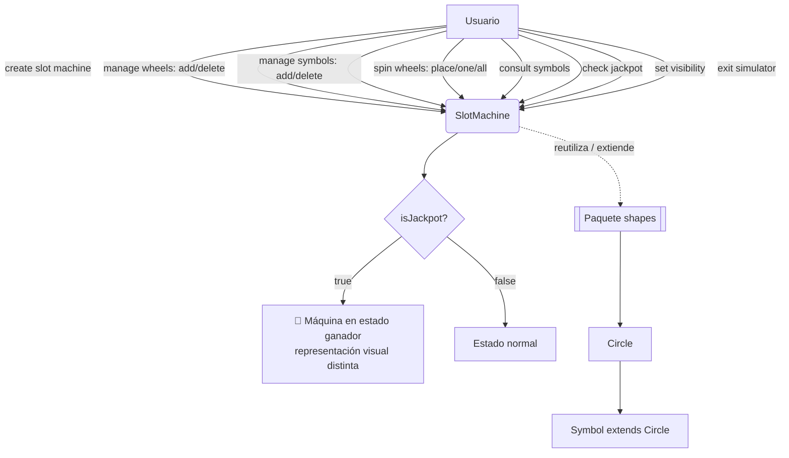
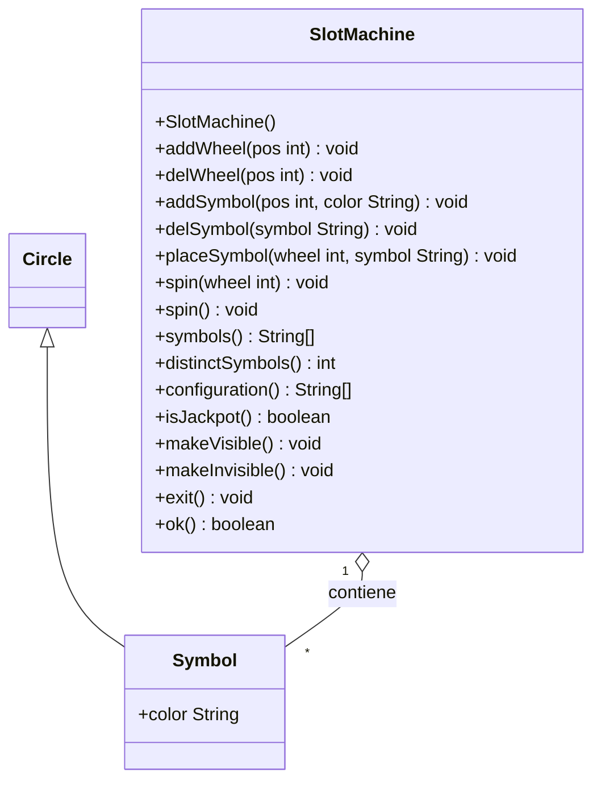

<div align="center">

El link de oneDrive lo utilizamos para guardar el astah y el documento word de respaldo.
<<<<<<< HEAD
https://pruebacorreoescuelaingeduco-my.sharepoint.com/:f:/r/personal/pablo_gualdron-l_mail_escuelaing_edu_co/Documents/proyecto1%20DOPO?d=w4c797642b0d9485189e7c813519d1ef8&csf=1&web=1&e=LxEJe3
=======
>>>>>>> 12f6933b140ee25f2fab97781eb6fe67b2ecd77f

<<<<<<< HEAD
# 🎰 slotMachine
=======
| | |
|---|---|
| **Curso** | Desarrollo Orientado por Objetos (DOPO-POOB) — Escuela Colombiana de Ingeniería Julio Garavito |
| **Autores** | Pablo Andrés Gualdrón Lindo Samuel Villagran |
| **Repositorio** | https://github.com/PaglkG/Proyecto1-DOPO |
| **Tecnología** | Java 8, JUnit 4.13.2, Maven, JaCoCo 0.8.10, PMD 3.21.2, VS Code (los ciclos 1 a 4 se hicieron en BlueJ) |
| **Estado** | Ciclos 1 a 5 completos |
>>>>>>> develop

### Simulador de Máquina Tragamonedas — DOPO-POOB 2026-2

*Inspirado en el Problema I "Slot Machine" — ICPC World Finals 2025, Baku*


```
   ┌───┐ ┌───┐ ┌───┐
   │ 🔴 │ │ 🟢 │ │ 🔵 │   ← ruedas con símbolos de colores
   └───┘ └───┘ └───┘
     ┃      ┃      ┃
   girar  girar  girar   →  ¿jackpot? 🎉
```

</div>

---

## 📌 Descripción General

**slotMachine** es un simulador orientado a objetos de una máquina tragamonedas de `n` ruedas, donde cada rueda contiene símbolos identificados **por color** (estándar CSS). El objetivo del Ciclo 1 es construir el **motor de simulación completo** —no resolver el problema competitivo de la maratón, sino sentar la base extensible sobre la cual, en ciclos futuros, se implementará la estrategia de juego descrita en el Problema I.

> 💡 **Nota:** Este proyecto reutiliza y extiende el paquete `shapes` (provisto por la Escuela), construyendo los símbolos de la rueda como figuras (`Symbol extends Circle`) coloreadas.

> ⚠️ **Importante:** El requisito implícito de **extensibilidad** rige todo el diseño: nuevas formas de símbolo, nuevas reglas de giro o nuevas visualizaciones deben poder añadirse sin reescribir la clase principal.

---

## 📂 Estructura del Repositorio

```
DOPOG01/
└── Laboratorios/
    └── slotMachine/
        ├── SlotMachine.java          # Clase principal — orquesta ruedas y reglas del juego
        ├── shapes/                    # Paquete base reutilizado y extendido
        │   ├── Circle.java
        │   ├── Symbol.java            # extends Circle — símbolo coloreado individual
        │   └── ...
        ├── docs/                      # Javadoc generado
        └── README.md
```

---

## 🧩 Componentes / Explicación Técnica

### 📄 Documento 1 — `Problema_I_Maquina_Tragamonedas.pdf` (ICPC 2025)

Define el problema competitivo original:

- Una máquina de `n` ruedas (3 ≤ n ≤ 50), cada una con `n` símbolos distintos en el mismo orden.
- El jugador **gira ruedas en secreto** (`girar rueda i, j posiciones`; `j` negativo invierte el sentido).
- Una "amiga" reporta, ronda a ronda, cuántos símbolos **distintos** son visibles (`k`).
- El objetivo competitivo es lograr `k = 1` (jackpot) en ≤ 10 000 acciones, **sin ver directamente las ruedas**.

Este documento es la **inspiración temática**, no el alcance de esta entrega: el algoritmo de resolución (adivinar/ganar con información parcial) queda para ciclos posteriores.

### 📄 Documento 2 — `_DOPO-I01-2026-02.pdf` (Especificación del Ciclo 1)

Traduce el problema anterior en un **simulador visual e interactivo**, con la clase principal `SlotMachine` y sus requisitos formales:

| Requisito funcional | Método asociado |
|---|---|
| Crear la máquina | `SlotMachine()` |
| Adicionar/eliminar rueda | `addWheel(pos)` / `delWheel(pos)` |
| Adicionar/eliminar símbolo | `addSymbol(pos, color)` / `delSymbol(symbol)` |
| Girar ruedas | `placeSymbol(...)`, `spin(wheel)`, `spin()` |
| Consultar símbolos | `symbols()`, `distinctSymbols()`, `configuration()` |
| Consultar jackpot | `isJackpot()` |
| Visibilidad | `makeVisible()` / `makeInvisible()` |
| Terminar | `exit()` |
| Estado de última operación | `ok()` |

**Reglas de diseño clave:**
- Los símbolos se identifican por **colores CSS estándar**.
- Posiciones indexadas desde **1**; fuera de rango se ajustan al límite más cercano (mínimo o máximo).
- `symbols()` retorna los colores de una rueda en orden desde la posición 1.
- `configuration()` retorna los colores visibles en **todas** las ruedas, de izquierda a derecha.
- Errores se comunican vía `JOptionPane`, **solo si el simulador está visible**.

---

## 🛠️ Flujo de Trabajo / Diagrama Visual





<<<<<<< HEAD
=======
| Clase | Responsabilidad |
|---|---|
| `SlotMachine` | Clase principal. Administra las ruedas (un `TreeMap` por posición), valida posiciones, lleva el estado de `ok()` y muestra los errores |
| `Wheel` | Una rueda: guarda sus símbolos, el símbolo seleccionado y si está fija (`lock`). Gira al azar, por pasos o lentamente, y se intercambia con otra |
| `Symbol` | Un símbolo de color (triángulo de 30 × 30) con su posición dentro de la rueda y el método `efect()` que las clases hijas sobrescriben |
| `SlotMachineContest` | Solución del problema de la maratón (`solve`) y su versión visible (`simulate`) |

## 4. Tipos de ruedas y símbolos (Ciclo 4)

| Tipo | Clase | Comportamiento |
|---|---|---|
| Rueda normal | `Wheel` | Gira al azar, se puede fijar, intercambiar y eliminar |
| Rueda **lefty** | `Lefty` | Si hay una rueda a su izquierda, al girar copia sus símbolos y su símbolo seleccionado; si no la hay, gira normal |
| Rueda **rebel** | `Rebel` | No se deja fijar (`lock` no hace nada), ni intercambiar ni eliminar (lanza `UnsupportedOperationException`) |
| Símbolo normal | `Symbol` | Triángulo de color |
| Símbolo **ephemeral** | `Ephemeral` | Con cada efecto reduce su tamaño (30 px, de 4 en 4) hasta quedar casi como un punto |
| Símbolo **shy** | `Shy` | Con cada efecto alterna entre visible e invisible |
| Símbolo **rotation** *(propuesto por el equipo)* | `Rotation` | Con cada efecto sube y baja 20 px |

Se crean con `addWheel("Lefty", pos)`, `addWheel("Rebel", pos)` y `addSymbol("Ephemeral" | "Shy" | "Rotation", pos, color)`. El efecto de cada símbolo especial (`efect()`) se verifica con sus pruebas de unidad.

## 5. Estructura del repositorio

```
Proyecto1-DOPO/
├── Ciclo1/ … Ciclo4/        Entrega de cada ciclo (enunciado, código en BlueJ y diseño en astah)
├── Ciclo5/                  Entrega final, abre esta carpeta en VS Code
│   ├── pom.xml              Maven: JUnit, JaCoCo y PMD
│   ├── Proyecto/
│   │   ├── lib/             junit-4.13.2.jar y hamcrest-core-1.3.jar
│   │   ├── shapes/          Canvas, Figure, Rectangle, Triangle, Polygon2D
│   │   └── slotMachine/     SlotMachine, Wheel, Lefty, Rebel, Symbol, Ephemeral, Shy,
│   │       │                Rotation, SlotMachineContest y pruebas de los símbolos
│   │       └── test/        SlotMachineAceptanceTest, SlotMachineC1Test, SlotMachineC2Test,
│   │                        WheelTest, WheelLeftyTest, WheelRebelTest
│   ├── ProblemSlotMachine/  Versión de consola del problema, test.txt y reulstado.txt
│   ├── target/              Reportes generados (surefire y JaCoCo)
│   ├── pmdAntesCorrecion.html   Informe PMD inicial
│   └── SlotMachineDesing.asta   Diseño completo en astah
└── proyecto inicial.pdf     Documento de entrega (ciclos 1 a 5 y retrospectiva)
```

## 6. Cómo ejecutarlo

**Requisitos:** JDK 8 o superior, Maven y VS Code con la *Extension Pack for Java*.

```bash
git clone https://github.com/PaglkG/Proyecto1-DOPO.git
cd Proyecto1-DOPO/Ciclo5

mvn clean test        # compila, corre las pruebas y genera el informe de JaCoCo
mvn pmd:pmd           # genera el informe de análisis estático
```

- Informe de cobertura: `Ciclo5/target/site/jacoco/index.html`.
- Para probar el simulador a mano, crea un `SlotMachine` en una clase de prueba o en el terminal de Java de VS Code. Las pruebas de aceptación (sección 9) abren la ventana gráfica del simulador.

## 7. Calidad: pruebas, JaCoCo y PMD (Ciclo 5)

**Pruebas de unidad (última ejecución registrada: 39 pruebas, 0 fallos, 0 errores)**

| Clase de prueba | Pruebas | Qué verifica |
|---|---|---|
| `SlotMachineC1Test` | 9 | Ciclo 1: ruedas, símbolos, configuración, jackpot, `placeSymbol`, `exit` |
| `SlotMachineC2Test` | 5 | Ciclo 2: `swap`, `lock`/`unlock`, configuración dada |
| `WheelTest` | 3 | Comportamiento de `Wheel` |
| `WheelLeftyTest` | 1 | La Lefty copia a su vecina de la izquierda |
| `WheelRebelTest` | 4 | La Rebel no se bloquea, no se intercambia ni se elimina |
| `SymbolEphemeralTest`, `SymbolShyTest`, `SymbolRotetionTest` | 2 + 1 + 1 | Efecto de cada símbolo especial |
| `SlotMachineAceptanceTest` | 13 | Pruebas de aceptación (ver sección 9) |

**Análisis dinámico (JaCoCo).** La meta era superar el 75 % de cubrimiento y ya se cumplía al empezar el ciclo.

| Paquete | Instrucciones | Ramas |
|---|---|---|
| `slotMachine` | 70 % | 48 % |
| `shapes` | 85 % | 70 % |
| `slotMachine.test` | 99 % | 100 % |
| `default` (clase del problema de consola) | 0 % | — |
| **Total** | **79 %** | **51 %** |

**Análisis estático (PMD)** con los conjuntos de reglas `bestpractices`, `codestyle` y `errorprone`. La meta era cumplir todas las reglas de prioridad alta. Se corrigieron las de prioridad 1 que no alteraban el código ni la lógica, entre ellas:

- No llamar a métodos sobrescribibles (`addWheel`, `addSymbol`, `spin`) dentro del constructor de `SlotMachine`.
- Nombres de variables locales en `camelCase` en lugar de `MAYÚSCULAS_CON_GUION`.
- Además, se atendieron avisos de prioridad 2 a 5: no reasignar parámetros, evitar `System.out.println`, usar llaves en los `if`, usar `final`, quitar importaciones sin usar y preferir interfaces (`Map`, `List`) sobre implementaciones concretas.

## 8. Retrospectiva

- **Tiempo invertido:** 15 h por integrante en el ciclo 1 y 18 h por integrante en los ciclos 2 y 3.
- **Mayores logros:** aplicar *Pair Programming* (ciclo 1) y *TDD* (ciclo 2), que dio seguridad de que cada funcionalidad exigida se cumplía.
- **Mayores problemas técnicos:** aprender GitHub a medida que se usaba (ciclo 1) y entender los requisitos (ciclo 2), que se resolvió hablando con la profesora para confirmar cada uno.
- **Qué se hizo bien como equipo:** comunicación, redistribución del trabajo y explicarse de forma sencilla lo que hizo cada uno.
- **Prácticas XP más útiles:** simplicidad (programar solo lo esencial y luego extender) y comunicación constante con el cliente.
- **Referencias:** Martin, R. C. (2012). *Código limpio: manual de estilo para el desarrollo ágil de software* (2.ª ed.). Anaya Multimedia. Google (2026). Gemini [modelo de lenguaje]. Anthropic (2026). Claude [modelo de lenguaje].

>>>>>>> develop
---

## 🚀 Guía de Inicio Rápido

### Requisitos previos

- **BlueJ** (IDE obligatorio según especificación).
- **JDK 8+**.
- Paquete `shapes` disponible en el proyecto.

### Pasos

```bash
# 1. Clonar el repositorio
git clone <url-del-repositorio>
cd Proyecto1-DOPO/

# 2. Abrir el proyecto en BlueJ
#    File > Open Project > seleccionar carpeta slotMachine

# 3. Compilar todas las clases desde BlueJ (Compile All)

# 4. Crear un objeto SlotMachine desde el panel de objetos
#    y ejecutar los métodos públicos interactivamente
```

> 💡 **Nota:** BlueJ permite invocar cada método público (`addWheel`, `spin`, `isJackpot`, etc.) directamente desde el menú contextual del objeto, ideal para probar el comportamiento sin escribir un `main`.

---

## 💡 Conceptos Clave Aprendidos

- **Reutilización por herencia:** `Symbol extends Circle` aprovecha el paquete `shapes` sin duplicar lógica geométrica.
- **Diseño por contrato con `ok()`:** patrón que reporta el éxito/fallo de la última operación, común en interfaces educativas antes de introducir excepciones.
- **Separación simulador vs. algoritmo:** el Ciclo 1 construye el *motor*; la *estrategia de resolución* (inspirada en el problema ICPC) se aborda en ciclos posteriores — buena práctica de diseño incremental (mini-ciclos).
- **Extensibilidad como requisito no funcional:** el diseño anticipa nuevas formas de símbolo o reglas de giro sin modificar la clase principal.
- **Interacción visible/invisible:** el simulador debe soportar modo "headless", útil para pruebas automatizadas (TDD/BDD).

---

*README.md generados automáticamente por Claude.*
