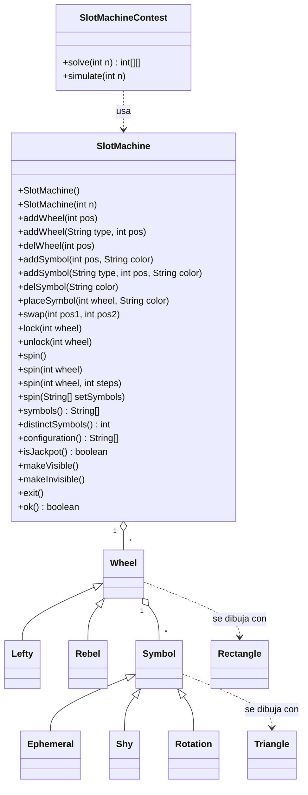

# SlotMachine — Proyecto Inicial DOPO 2026-2

Simulador orientado a objetos de una máquina tragamonedas, inspirado en el **Problem I (Slot Machine)** de la maratón de programación internacional 2025. Cada rueda guarda símbolos de colores distintos y la máquina gana (*jackpot*) cuando todos los símbolos seleccionados tienen el mismo color.

| | |
|---|---|
| **Curso** | Desarrollo Orientado por Objetos (DOPO-POOB) — Escuela Colombiana de Ingeniería Julio Garavito |
| **Autores** | Pablo Andrés Gualdrón Lindo Samuel Villagran |
| **Repositorio** | https://github.com/PaglkG/Proyecto1-DOPO |
| **Tecnología** | Java 8, JUnit 4.13.2, Maven, JaCoCo 0.8.10, PMD 3.21.2, VS Code (los ciclos 1 a 4 se hicieron en BlueJ) |
| **Estado** | Ciclos 1 a 5 completos |

## Contenido

1. [Resumen del proyecto](#1-resumen-del-proyecto)
2. [Ciclos de desarrollo](#2-ciclos-de-desarrollo)
3. [Diseño](#3-diseño)
4. [Tipos de ruedas y símbolos](#4-tipos-de-ruedas-y-símbolos-ciclo-4)
5. [Estructura del repositorio](#5-estructura-del-repositorio)
6. [Cómo ejecutarlo](#6-cómo-ejecutarlo)
7. [Calidad: pruebas, JaCoCo y PMD](#7-calidad-pruebas-jacoco-y-pmd-ciclo-5)
8. [Retrospectiva](#8-retrospectiva)
9. [Prueba de aceptación](#9-prueba-de-aceptación)

---

## 1. Resumen del proyecto

El proyecto se construyó en cinco ciclos de refactorización y extensión. Primero se hizo el **simulador** (ruedas, símbolos, giros y consultas), luego se le agregaron **bloqueos, intercambios y giros controlados**, después se resolvió el **problema de la maratón** sobre ese simulador, se añadieron **tipos de ruedas y símbolos** y, por último, se midió y mejoró la calidad con **JaCoCo y PMD** en VS Code.

Reglas de diseño que atraviesan todo el proyecto:

- Los símbolos se identifican por **color** (nombres de la paleta del `Canvas`, por ejemplo `red`, `blue`, `magenta`, o códigos hexadecimales).
- Las posiciones de las ruedas empiezan en **1** y se leen de izquierda a derecha.
- Al adicionar o eliminar una rueda, una posición fuera de rango se ajusta al límite más cercano. En las demás operaciones, una rueda que no existe invalida la acción.
- `ok()` informa si la última operación se pudo realizar. Si la acción falla y el simulador está **visible**, se muestra un mensaje con `JOptionPane`; en modo invisible no se muestra nada.
- **Extensibilidad:** los tipos de rueda y de símbolo se crean por nombre de clase (reflexión), así que se agregan tipos nuevos sin modificar `SlotMachine`.
- Se reutiliza el paquete `shapes` (`Canvas`, `Rectangle`, `Triangle`, `Figure`, `Polygon2D`): cada rueda se dibuja con un `Rectangle` y cada símbolo con un `Triangle`.

## 2. Ciclos de desarrollo

| Ciclo | Objetivo | Qué se construyó | Mini-ciclos |
|---|---|---|---|
| **1** | Simulador base (requisitos 1 a 8) | `SlotMachine`, `Wheel`, `Symbol`: crear la máquina, adicionar y eliminar ruedas y símbolos, girar, consultar símbolos, `isJackpot()`, visibilidad, `exit()` y `ok()` | 1) máquina, ruedas y símbolos · 2) consultas y `placeSymbol` · 3) giro, jackpot, `ok`, `exit` · 4) visibilidad |
| **2** | Extensión del simulador (requisitos 9 a 12) | `swap`, `lock`, `unlock`, `spin(rueda, pasos)` con movimiento paso a paso si está visible (`spinSlowly`) y `spin(String[])` para dejar una configuración dada | 1) intercambiar y fijar ruedas · 2) giros con pasos y configuración dada |
| **3** | Resolver el problema de la maratón | `SlotMachineContest` con `solve(n)`, `simulate(n)`, `different`, `identical` y `printOI`; archivos de prueba del problema en `ProblemSlotMachine/` | 1) `printOI`, `different` y prueba de depuración · 2) `identical`, `simulate`, `solve` |
| **4** | Tipos de ruedas y símbolos (requisitos 16 a 19) | `Lefty` y `Rebel` (ruedas); `Ephemeral`, `Shy` y `Rotation` (símbolos, el último es la propuesta propia); `addWheel(tipo, pos)` y `addSymbol(tipo, pos, color)` | 1) constructores de los tipos · 2) comportamiento propio de cada tipo · 3) `addWheel` con tipo · 4) giros adaptados a los tipos |
| **5** | Cierre: herramientas modernas | Proyecto en **VS Code** con Maven (`pom.xml`), informe de cobertura con **JaCoCo** e informe de análisis estático con **PMD** | Migración desde BlueJ, cobertura, corrección de reglas PMD |

## 3. Diseño



| Clase | Responsabilidad |
|---|---|
| `SlotMachine` | Clase principal. Administra las ruedas (un `TreeMap` por posición), valida posiciones, lleva el estado de `ok()` y muestra los errores |
| `Wheel` | Una rueda: guarda sus símbolos, el símbolo seleccionado y si está fija (`lock`). Gira al azar, por pasos o lentamente, y se intercambia con otra |
| `Symbol` | Un símbolo de color (triángulo de 30 × 30) con su posición dentro de la rueda y el método `efect()` que las clases hijas sobrescriben |
| `SlotMachineContest` | Solución del problema de la maratón (`solve`) y su versión visible (`simulate`) |

## 4. Tipos de ruedas y símbolos (Ciclo 4)

| Tipo | Clase | Comportamiento |
|---|---|---|
| Rueda normal | `Wheel` | Gira al azar, se puede fijar, intercambiar y eliminar |
| Rueda **lefty** | `Lefty` | Si hay una rueda a su izquierda, al girar copia sus símbolos y su símbolo seleccionado; si no la hay, gira normal |
| Rueda **rebel** | `Rebel` | No se deja fijar (`lock` no hace nada), ni intercambiar ni eliminar (lanza `UnsupportedOperationException`) |
| Símbolo normal | `Symbol` | Triángulo de color |
| Símbolo **ephemeral** | `Ephemeral` | Con cada efecto reduce su tamaño (30 px, de 4 en 4) hasta quedar casi como un punto |
| Símbolo **shy** | `Shy` | Con cada efecto alterna entre visible e invisible |
| Símbolo **rotation** *(propuesto por el equipo)* | `Rotation` | Con cada efecto sube y baja 20 px |

Se crean con `addWheel("Lefty", pos)`, `addWheel("Rebel", pos)` y `addSymbol("Ephemeral" | "Shy" | "Rotation", pos, color)`. El efecto de cada símbolo especial (`efect()`) se verifica con sus pruebas de unidad.

## 5. Estructura del repositorio

```
Proyecto1-DOPO/
├── Ciclo1/ … Ciclo4/        Entrega de cada ciclo (enunciado, código en BlueJ y diseño en astah)
├── Ciclo5/                  Entrega final, abre esta carpeta en VS Code
│   ├── pom.xml              Maven: JUnit, JaCoCo y PMD
│   ├── Proyecto/
│   │   ├── lib/             junit-4.13.2.jar y hamcrest-core-1.3.jar
│   │   ├── shapes/          Canvas, Figure, Rectangle, Triangle, Polygon2D
│   │   └── slotMachine/     SlotMachine, Wheel, Lefty, Rebel, Symbol, Ephemeral, Shy,
│   │       │                Rotation, SlotMachineContest y pruebas de los símbolos
│   │       └── test/        SlotMachineAceptanceTest, SlotMachineC1Test, SlotMachineC2Test,
│   │                        WheelTest, WheelLeftyTest, WheelRebelTest
│   ├── ProblemSlotMachine/  Versión de consola del problema, test.txt y reulstado.txt
│   ├── target/              Reportes generados (surefire y JaCoCo)
│   ├── pmdAntesCorrecion.html   Informe PMD inicial
│   └── SlotMachineDesing.asta   Diseño completo en astah
└── proyecto inicial.pdf     Documento de entrega (ciclos 1 a 5 y retrospectiva)
```

## 6. Cómo ejecutarlo

**Requisitos:** JDK 8 o superior, Maven y VS Code con la *Extension Pack for Java*.

```bash
git clone https://github.com/PaglkG/Proyecto1-DOPO.git
cd Proyecto1-DOPO/Ciclo5

mvn clean test        # compila, corre las pruebas y genera el informe de JaCoCo
mvn pmd:pmd           # genera el informe de análisis estático
```

- Informe de cobertura: `Ciclo5/target/site/jacoco/index.html`.
- Para probar el simulador a mano, crea un `SlotMachine` en una clase de prueba o en el terminal de Java de VS Code. Las pruebas de aceptación (sección 9) abren la ventana gráfica del simulador.

## 7. Calidad: pruebas, JaCoCo y PMD (Ciclo 5)

**Pruebas de unidad (última ejecución registrada: 39 pruebas, 0 fallos, 0 errores)**

| Clase de prueba | Pruebas | Qué verifica |
|---|---|---|
| `SlotMachineC1Test` | 9 | Ciclo 1: ruedas, símbolos, configuración, jackpot, `placeSymbol`, `exit` |
| `SlotMachineC2Test` | 5 | Ciclo 2: `swap`, `lock`/`unlock`, configuración dada |
| `WheelTest` | 3 | Comportamiento de `Wheel` |
| `WheelLeftyTest` | 1 | La Lefty copia a su vecina de la izquierda |
| `WheelRebelTest` | 4 | La Rebel no se bloquea, no se intercambia ni se elimina |
| `SymbolEphemeralTest`, `SymbolShyTest`, `SymbolRotetionTest` | 2 + 1 + 1 | Efecto de cada símbolo especial |
| `SlotMachineAceptanceTest` | 13 | Pruebas de aceptación (ver sección 9) |

**Análisis dinámico (JaCoCo).** La meta era superar el 75 % de cubrimiento y ya se cumplía al empezar el ciclo.

| Paquete | Instrucciones | Ramas |
|---|---|---|
| `slotMachine` | 70 % | 48 % |
| `shapes` | 85 % | 70 % |
| `slotMachine.test` | 99 % | 100 % |
| `default` (clase del problema de consola) | 0 % | — |
| **Total** | **79 %** | **51 %** |

**Análisis estático (PMD)** con los conjuntos de reglas `bestpractices`, `codestyle` y `errorprone`. La meta era cumplir todas las reglas de prioridad alta. Se corrigieron las de prioridad 1 que no alteraban el código ni la lógica, entre ellas:

- No llamar a métodos sobrescribibles (`addWheel`, `addSymbol`, `spin`) dentro del constructor de `SlotMachine`.
- Nombres de variables locales en `camelCase` en lugar de `MAYÚSCULAS_CON_GUION`.
- Además, se atendieron avisos de prioridad 2 a 5: no reasignar parámetros, evitar `System.out.println`, usar llaves en los `if`, usar `final`, quitar importaciones sin usar y preferir interfaces (`Map`, `List`) sobre implementaciones concretas.

## 8. Retrospectiva

- **Tiempo invertido:** 15 h por integrante en el ciclo 1 y 18 h por integrante en los ciclos 2 y 3.
- **Mayores logros:** aplicar *Pair Programming* (ciclo 1) y *TDD* (ciclo 2), que dio seguridad de que cada funcionalidad exigida se cumplía.
- **Mayores problemas técnicos:** aprender GitHub a medida que se usaba (ciclo 1) y entender los requisitos (ciclo 2), que se resolvió hablando con la profesora para confirmar cada uno.
- **Qué se hizo bien como equipo:** comunicación, redistribución del trabajo y explicarse de forma sencilla lo que hizo cada uno.
- **Prácticas XP más útiles:** simplicidad (programar solo lo esencial y luego extender) y comunicación constante con el cliente.
- **Referencias:** Martin, R. C. (2012). *Código limpio: manual de estilo para el desarrollo ágil de software* (2.ª ed.). Anaya Multimedia. Google (2026). Gemini [modelo de lenguaje]. Anthropic (2026). Claude [modelo de lenguaje].

---

## 9. Prueba de aceptación

Primero, acomodé la máquina para que mostrara los colores que yo quería: magenta, verde y azul, y comprobé que quedaran exactamente en ese orden. Luego, cambié de posición la primera y la tercera rueda, y al hacer eso, vi que los colores ahora estaban al revés: azul, verde y magenta. Después de esto, bloqueé la primera y la tercera rueda para probar qué pasaba. Cuando hice esto e intenté darle un giro completo a la máquina, me di cuenta de que solo dio vueltas la rueda del medio; las que había bloqueado ni se movieron, y me saltó una ventanita de error en la pantalla. Para estar seguro de que de verdad estaban trabadas, intenté cambiarlas de lugar de nuevo y hasta traté de eliminar la tercera rueda, pero el programa no me dejó hacer absolutamente nada. Las ruedas se quedaron ahí quietas, intactas, y me volvió a salir el mensaje de que no estaba permitido hacer eso.

### Paso a paso

**Ciclo 1 — Simulador base**

1) **Crear la máquina:** `new SlotMachine()`. → `ok()` es `true` y la máquina no tiene ruedas.
2) **Hacerla visible:** `makeVisible()`. → Aparece el cuerpo rosado de la máquina en el canvas.
3) **Adjuntar tres ruedas:** `addWheel(1)`, `addWheel(2)` y `addWheel(3)`. → Se ven tres ruedas grises de izquierda a derecha; `ok()` es `true` tras cada una.
4) **Adjuntar símbolos a cada rueda:** `addSymbol(rueda, color)` con los colores de la tabla anterior. → Cada rueda muestra su primer símbolo (`magenta`, `red`, `blue`); `ok()` es `true`.
5) **Consultar todos los símbolos:** `symbols()`. → `[magenta, red, cyan, red, green, orange, blue, red, yellow]`.
6) **Consultar lo que muestra la máquina:** `configuration()`, `distinctSymbols()` e `isJackpot()`. → `[magenta, red, blue]`, `3` y `false`.
7) **Eliminar un símbolo de todas las ruedas:** `delSymbol("yellow")`. → `yellow` desaparece de la rueda 3 y de `symbols()`; lo que se ve en la máquina no cambia.
8) **Adjuntar y eliminar una rueda:** `addWheel(4)` y después `delWheel(4)`. → La máquina vuelve a tener tres ruedas; `ok()` es `true` en ambas operaciones.
9) **Dejar el mismo color en todas las ruedas:** `placeSymbol(1, "red")`, `placeSymbol(2, "red")` y `placeSymbol(3, "red")`. → `configuration()` es `[red, red, red]`, `distinctSymbols()` es `1` e `isJackpot()` es `true`.
10) **Girar una rueda y luego todas:** `spin(2)` y `spin()`. → Cada rueda elige un símbolo al azar; `ok()` es `true` y `configuration()` devuelve tres colores.
11) **Provocar una acción inválida:** `addSymbol(9, "red")` (la rueda 9 no existe). → `ok()` es `false` y aparece un mensaje de error (`JOptionPane`); se cierra el mensaje.

**Ciclo 2 — Intercambio, bloqueo y giros controlados**

12) **Dejar la máquina en una configuración dada:** `spin(new String[]{"magenta", "green", "blue"})`. → `configuration()` es `[magenta, green, blue]`; `ok()` es `true`.
13) **Intercambiar dos ruedas:** `swap(1, 3)`. → Las ruedas 1 y 3 cambian de lugar; `configuration()` es `[blue, green, magenta]`.
14) **Rotar una rueda un número de pasos:** `spin(2, 2)`. → La rueda 2 avanza paso a paso, con una pausa entre símbolos, y queda en `red`; `configuration()` es `[blue, red, magenta]`.
15) **Fijar dos ruedas:** `lock(1)` y `lock(3)`. → `ok()` es `true`.
16) **Girar con ruedas fijas:** `spin()`. → Solo gira la rueda 2; las ruedas 1 y 3 conservan su símbolo; `ok()` es `false` y aparece el mensaje de error.
17) **Intentar intercambiar y eliminar una rueda fija:** `swap(1, 3)` y `delWheel(3)`. → Las dos operaciones se rechazan (`ok()` es `false`) y las ruedas quedan en su lugar.
18) **Soltar las ruedas y girar:** `unlock(1)`, `unlock(3)` y `spin()`. → Las tres ruedas giran; `ok()` es `true`.

**Ciclo 3 — Problema de la maratón**

19) **Resolver el problema con 3 ruedas:** `SlotMachineContest.solve(3)`. → Devuelve la secuencia de movimientos `{rueda, giros}` que se aplica hasta lograr `k = 1` (jackpot).
20) **Ver la solución en pantalla:** `SlotMachineContest.simulate(3)`. → Se muestra una máquina visible y se observa cómo los giros llevan al jackpot.

**Ciclo 4 — Tipos de ruedas y de símbolos**

21) **Adjuntar una rueda Lefty a la derecha:** `addWheel("Lefty", 4)`. → Aparece la rueda 4; `ok()` es `true`.
22) **Adjuntar una rueda Rebel con símbolos:** `addWheel("Rebel", 5)`, `addSymbol(5, "red")`, `addSymbol(5, "green")` y `addSymbol(5, "blue")`. → Aparece la rueda 5 con tres símbolos; `ok()` es `true`.
23) **Adjuntar un símbolo especial a las ruedas 1, 2 y 3:** `addSymbol("Ephemeral", 1, "gray")`, `addSymbol("Shy", 2, "black")` y `addSymbol("Rotation", 3, "magenta")`. → Cada rueda recibe un símbolo más; `ok()` es `true`.
24) **Girar la rueda Lefty:** `spin(4)`. → La rueda 4 copia los símbolos y el estado de la rueda 3; `configuration()` muestra el mismo color en las posiciones 3 y 4.
25) **Girar todas las ruedas:** `spin()`. → Las ruedas 3 y 4 siguen mostrando el mismo color (la Lefty copia a su vecina); las demás giran al azar; `ok()` es `true`.
26) **Comprobar que la Rebel no se deja fijar:** `lock(5)` y `spin()`. → La rueda 5 no queda fija y el giro de toda la máquina funciona; `ok()` es `true`.
27) **Comprobar que la Rebel no se elimina:** `delWheel(5)`. → Se rechaza con `UnsupportedOperationException` ("A rebel wheel cannot be deleted.") y la rueda 5 sigue en la máquina.
28) **Comprobar que la Rebel no se intercambia:** `swap(5, 1)`. → Se rechaza con `UnsupportedOperationException` ("A rebel wheel cannot be swap.") y el orden de las ruedas no cambia.
29) **Verificar los efectos de los símbolos especiales:** ejecutar `SymbolEphemeralTest`, `SymbolShyTest` y `SymbolRotetionTest`. → Pasan: Ephemeral se encoge, Shy alterna visible e invisible y Rotation sube y baja.

**Ciclo 5 — Calidad con herramientas modernas**

30) **Abrir el proyecto en VS Code:** abrir la carpeta `Ciclo5` con la extensión de Java. → El proyecto se reconoce con `pom.xml` y las clases de prueba no marcan errores de importación.
31) **Ejecutar todas las pruebas:** `mvn clean test`. → 39 pruebas sin fallos ni errores, incluidas las 13 de `SlotMachineAceptanceTest`.
32) **Abrir el informe de cobertura:** `target/site/jacoco/index.html`. → La cobertura total ronda el 79 % de instrucciones, por encima de la meta del 75 %.
33) **Generar y abrir el informe de PMD:** `mvn pmd:pmd` y abrir el `pmd.html` resultante. → Las violaciones de prioridad 1 que no afectaban el código ni la lógica aparecen corregidas respecto de `pmdAntesCorrecion.html`.

**Cierre**

34) **Pasar a modo invisible y repetir una acción inválida:** `makeInvisible()` y `addSymbol(9, "red")`. → Todo desaparece del canvas; `ok()` es `false` pero no aparece ningún mensaje.
35) **Terminar el simulador:** `exit()`. → Se cierra la ventana y se eliminan todas las ruedas.
